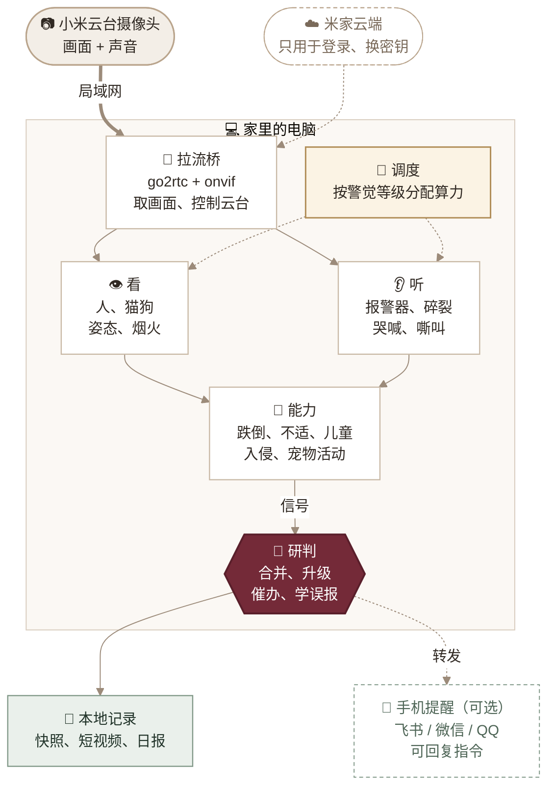
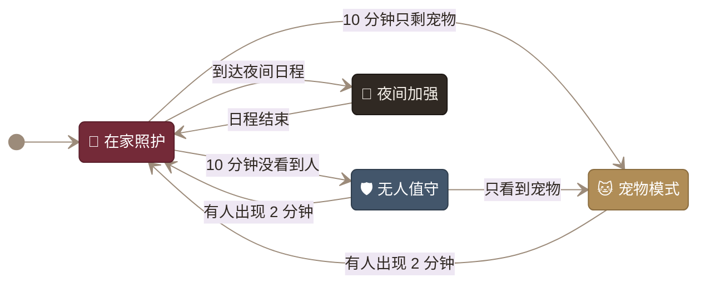

<div align="center">


# 米执事 · Mi Butler

**把小米云台摄像头变成家里的值班管家。**

没人时看家，有人时照看，养宠时记录。<br>
画面在本机分析，有事才叫你。

[](https://github.com/JuneYaooo/caregiving-eye/stargazers)
[](./requirements.txt)
[](#执事怎样工作)
[](#三种场景执事都在做什么)
[](./LICENSE)

[三种场景](#三种场景执事都在做什么) · [怎样工作](#执事怎样工作) · [调度](#调度省算力长期跑) · [快速开始](#快速开始) · [回复指令](#提醒和回复) · [开源组件](#用到的开源项目) · [常见问题](./docs/getting-started.md#常见问题)

</div>

---

米执事（`caregiving-eye`）是一套在家里电脑上运行的视觉照护工具。它接入小米云台摄像头，同时分析画面和声音，并根据家里有没有人切换值班重点：没人时防火防盗；有人时留意跌倒、突发不适和孩子的安全；养宠物时记录它一天去了哪里、活动了多久。

不刷固件，不改硬件。视频和声音只在局域网内传输、在本机分析；登录和连接摄像头时，仍需向米家云端换取流密钥。

## 三种场景，执事都在做什么

<table>
<tr>
<td width="33%" valign="top">

### 🛡️ 家里没人

**无人值守**

- **火焰 / 烟雾**：画面里持续出现才提醒；同时听到烟雾报警器声时直接急报
- **入侵**：发现人形就抓拍，并保存前后一段短视频；可以让云台转过去跟着看
- **异常声响**：玻璃碎裂、撞击声
- **长时间无人**：几小时没人回家时记一笔

</td>
<td width="33%" valign="top">

### 🧓 家里有人

**在家照护 · 夜间加强**

- **跌倒**：站着的人突然倒地
- **倒地久卧**：倒地后迟迟没起身（床、沙发等休息区除外）
- **突发不适**：在异常位置倒卧、长时间不动、抽动、呻吟呼喊，至少两种信号同时出现才急报
- **儿童危险**：孩子独自靠近灶台、窗台、大门，附近没有大人
- 婴儿哭声、卫生间停留过久、夜间离床

</td>
<td width="33%" valign="top">

### 🐱 养了宠物

**宠物模式**

- **活动热力图**：一天常待在哪里，叠加在家里的画面上
- **活动总结**：出现次数、活跃时长、最活跃时段、24 小时分布
- **区域停留**：猫爬架、食盆、猫砂盆各去了几次、待了多久
- **禁区提醒**：上桌、上灶台时抓拍
- 嘶叫哀鸣、长时间没露面

</td>
</tr>
</table>

所有模式都会把事件写进本地记录，重要事件附快照和前后约 25 秒的短视频。运行 `python report.py` 可以生成日报，内容包括当天事件、宠物与家人的活动总结和热力图。各模式具体启用哪些能力，见 [接入指南](./docs/getting-started.md#各模式启用的能力)。

> 所有判断都由规则和开源模型组合完成，需要按自家机位标定区域、校准阈值，可能误报或漏报。**它不能替代专业监护设备或消防报警设备。**

## 执事怎样工作

摄像头的画面和声音经局域网进入家里的电脑，先由“看”和“听”两路模型识别，再交给各项能力判断。能力只上报信号，最后由研判层决定要不要提醒你。



### 调度：省算力，长期跑

能力一多，就要决定每一刻跑哪些模型、跑多快。这部分由调度层（`brain/`）负责：

| 情况 | 做法 |
| --- | --- |
| 画面静止、没人 | 三档警觉等级：画面静止时检测降到约 0.7 帧/秒，有动静时升到 3 帧/秒，有事件时升到 5 帧/秒。姿态模型只在有人时跑；火焰模型闲时 5 秒查一次，有可疑立即加密；声音太小时不跑模型 |
| 串行与并行 | 模型推理在主循环里串行，避免互相抢 CPU；写录像、发消息、转云台、清磁盘放到后台并行；拉流和听声音是常驻线程 |
| 不同类型的任务 | 常驻服务由看门狗盯着，挂了自动重启；周期任务按值班表运行；抓拍、转云台、日报是一次性或每日任务 |
| 同一件事反复报 | 能力只上报信号，由研判层合并成一个事件：级别升高时才再次提醒，急报没人回就催办，回复“没事”会记住这个位置的误报 |
| 连续运行几个月 | 断流后退避重连；某项能力报错只暂停它自己；磁盘按天数和容量自动清理；日志轮转；每 30 秒写一次心跳文件 `events/status.json` |

完整的值班表和设计说明见 [执事的大脑](./docs/brain.md)。

### 值班模式自动切换

执事根据画面里有没有人、有没有宠物自动换班，也可以按日程（如 23:00–07:00 夜间）或一条指令切换。优先级是：指令 > 日程 > 自动。自动切换带防抖，不会因为一两帧画面来回切。



### 提醒分级

| 级别 | 什么时候 | 例子 |
| --- | --- | --- |
| 〔急报〕 | 需要马上有人去看，静音时也会发 | 跌倒、倒地久卧、突发不适、儿童独自进危险区、确认火情 |
| 〔值守〕 | 值得留意 | 入侵、疑似烟火、玻璃碎裂、夜间离床、长时间无动作 |
| 〔宠物〕 | 宠物相关 | 上了禁区、嘶叫哀鸣、久未露面 |
| 〔执事〕 | 日常记录 | 模式切换、长时间无人、日报 |

同一个人的跌倒、久卧、不适会合并成一个事件，只在级别升高时再提醒；急报没人回复时，每 3 分钟催一次。火情、突发不适这类判断要多个信号互相印证才升级，以减少误报：


## 快速开始

> [!TIP]
> 建议交给自己电脑上的本地 AI agent（如 Claude Code、Codex、OpenClaw 等）来部署：把本项目链接 `https://github.com/JuneYaooo/caregiving-eye` 发给它，它会自己读文档、检查环境、安装依赖并完成接入。整个过程需要访问本机文件、局域网摄像头和米家账号，所以要用跑在本机的 agent，不要用云端的。
>
> 运行 agent 的这台电脑要和摄像头连在同一个局域网（同一个路由器 / Wi-Fi）下：拉视频流、转云台、扫描摄像头 IP 都只在局域网内进行，不在同一网络时 agent 找不到摄像头。

已实测设备：小米智能摄像机 3 云台版，其他机型和固件版本还需要验证。完整的接入流程按 Windows x64 + Python 3.9+ 编写。

| 步骤 | 做什么 | 入口 |
| --- | --- | --- |
| 01 · 准备环境 | 克隆仓库，安装依赖，配置 `.env`，下载模型 | [环境与配置](./docs/getting-started.md#1-准备环境) |
| 02 · 接入摄像头 | 下载配套补丁版二进制，登录米家，填写 `go2rtc.yaml` | [视频与云台](./docs/getting-started.md#2-接入摄像头) |
| 03 · 开始值班 | 标定区域，启动执事，查看日报，按需接入外部提醒 | [检测与提醒](./docs/getting-started.md#3-运行检测与提醒) |

依赖、模型和 RTSP 视频流准备好以后，在仓库根目录运行：

```powershell
# 1. 先用基础管线确认视频与模型正常
python care_pipeline.py --source rtsp://127.0.0.1:8554/living --no-display

# 2. 停掉上面的管线，启动执事（启动日志会列出值班表和实际启用的能力）
python care_v2.py --source rtsp://127.0.0.1:8554/living

# 也可以用自家录像回放来校准区域和阈值
python care_v2.py --source my_living_room.mp4

# 3. 随时生成今天的日报：事件 + 宠物 / 家人活动 + 热力图
python report.py
```

火焰烟雾、声音事件和 ByteTrack 跟踪是可选能力：放好对应模型或装好依赖就会自动启用，缺了就跳过，不影响其他功能。下载方式见 [可选模型](./docs/getting-started.md#可选模型按需下载缺了对应能力会自动跳过)。

<details>
<summary>项目结构</summary>

```text
care_v2.py          执事主程序：组件装配 + 值班表
butler.py           值班模式引擎、提醒措辞、推送、主人指令
brain/
  runtime.py        任务调度：周期 / 触发 / 一次性 / 每日，cpu 与 io 两条车道
  frames.py         拉流服务：只留最新帧，断流重连
  gate.py           动静判断与警觉等级
  incidents.py      事件研判：合并、升级、催办、结案、学误报
  upkeep.py         磁盘清理、日志轮转、心跳
  ptz.py            云台独占控制与复位
report.py           日报：事件汇总、活动总结、热力图
abilities/
  fire.py           火焰 / 烟雾视觉检测
  audio.py          声音事件（YAMNet）
  illness.py        突发不适多信号判断
  child.py          儿童判定与危险区域
  pet.py            宠物 / 家人活动记录与热力图
  clips.py          事件前后短视频存证
  tracking.py       跟踪器（内置 IoU / 可选 ByteTrack）
care_pipeline.py    基础检测管线与 ONNX 推理
onvif_ptz.py        云台控制
mi_login.py 等      米家登录与设备查询
```

</details>

## 提醒和回复

提醒默认只写进本地记录 `events/alerts.jsonl`。如果想在手机上收到提醒，可以配合 OpenClaw、Hermes、WorkBuddy、ZCode、Claude Code、Codex 等 AI 工具，读取这个文件并转发到飞书、微信或 QQ。本项目不内置这些平台的机器人，接入方式参考 [OpenClaw 消息渠道](https://docs.openclaw.ai/channels) 和 [Hermes 消息网关](https://hermes-agent.nousresearch.com/docs/user-guide/messaging/)，细节见 [接入指南](./docs/getting-started.md#可选飞书微信与-qq-机器人提醒)。

执事运行时会在本机开一个指令入口 `http://127.0.0.1:8766/command`，只监听本机，不对局域网开放。机器人收到你的回复后转发到这里即可，也可以在命令行里直接发：

```powershell
python butler.py cmd 没事        # 记为误报，同一位置误报多了会自动降级
python butler.py cmd 收到        # 停止催办
python butler.py cmd 是我        # 解除入侵提醒，切到在家照护
curl -d "状态" http://127.0.0.1:8766/command
```

其他指令：`看看`（立即抓拍）、`静音2小时`、`模式 away`、`日报`。端口由 `.env` 里的 `COMMAND_PORT` 设置，设为 `0` 则关闭入口。

## 用到的开源项目

| 用途 | 项目 | 许可证 |
| --- | --- | --- |
| 拉流 | [go2rtc](https://github.com/AlexxIT/go2rtc) · [xiaomi-onvif](https://github.com/SincereXIA/xiaomi-onvif) | MIT |
| 人 / 宠物检测、人体姿态 | [Ultralytics YOLOv8](https://github.com/ultralytics/ultralytics)（n / n-pose） | AGPL-3.0 |
| 火焰 / 烟雾 | [D-Fire 数据集](https://github.com/gaiasd/DFireDataset) 训练的 [fire-smoke-yolov8n](https://huggingface.co/rabahdev/fire-smoke-yolov8n) | AGPL-3.0 |
| 声音事件 | Google [YAMNet](https://github.com/tensorflow/models/tree/master/research/audioset/yamnet) 的 [ONNX 版](https://huggingface.co/audiomagic/yamnet-onnx)（AudioSet 521 类） | Apache-2.0 |
| 多目标跟踪（可选） | [supervision](https://github.com/roboflow/supervision) 内置 ByteTrack | MIT |
| 推理 | [ONNX Runtime](https://github.com/microsoft/onnxruntime) · [OpenCV](https://github.com/opencv/opencv) | MIT · Apache-2.0 |

本项目代码采用 MIT 许可证；模型权重和数据集遵循各自上游的许可证，商用前请自行确认。

## 实测记录

下表来自项目已有的单设备测试记录，不代表检测准确率，也不代表所有网络环境下的性能。火焰烟雾、声音、儿童、突发不适、宠物活动和调度层目前只用合成画面验证过流程，还没有在真实画面上实测。

| 项目 | 已记录结果 | 观察方式 |
| --- | --- | --- |
| 视频流 | H.265 · 2960 × 1666 实时出流 | OpenCV 解码与画面时间水印 |
| 本地检测 | 35 秒分析 333 帧；一次 `person` 检出置信度 0.88 | 实时流检测输出 |
| 手动云台 | `ContinuousMove` 右转约 15–20° | 指令前后画面对比 |

## 使用边界与隐私

- **需要联网取密钥**：每次连接摄像头都要向米家云端换取流密钥，目前不是完全离线的方案。
- **不能替代专业设备**：火情以烟雾报警器为准，照护以专业监护设备为准。
- **提醒按需接入**：默认只记录在本地；接入外部机器人时，可以只转发事件文字，不转发画面。
- **只在可信网络中使用**：不要把 RTSP、go2rtc 或 ONVIF 控制端口直接暴露到公网。
- **家庭数据留在本地**：账号、凭据、设备清单、家庭画面、录像和区域配置都保存在本机；只在自己家中，或已获得明确同意的场合使用。
- **先校准再使用**：遮挡、光线、拍摄角度和云台转动都会影响判断；云台转动后需要重新标定区域。

还没做的：双向对讲、基于骨架时序模型（ST-GCN）的跌倒分类、作息偏离提醒。三项都可以做，设计思路见 [能力设计](./docs/butler.md) 和 [算法设计](./docs/algorithms.md)：

- **作息偏离**：最容易。每小时活动统计已经在累计，攒够约两周数据后，按小时和历史对比就能提醒"今天 10 点还没起"。
- **ST-GCN 跌倒分类**：可行。现有的 YOLOv8n-pose 关键点直接当输入，用 UR Fall、UP-Fall 等公开数据集训练，模型很小，CPU 也能跑；上线后和现有规则并联，两者都判跌倒才急报。
- **双向对讲**：go2rtc 的 xiaomi 源支持双向音频，技术上能打通；不同机型和固件是否支持喊话还要实测。

想自己补上，可以把本项目链接和这几份设计文档交给本地 agent，让它按文档实现。

<div align="center">

项目代码采用 [MIT License](./LICENSE) · 社区交流：[LINUX DO](https://linux.do/)

</div>
