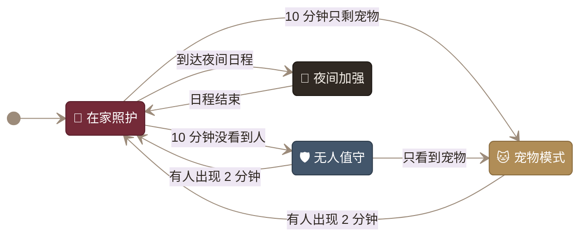
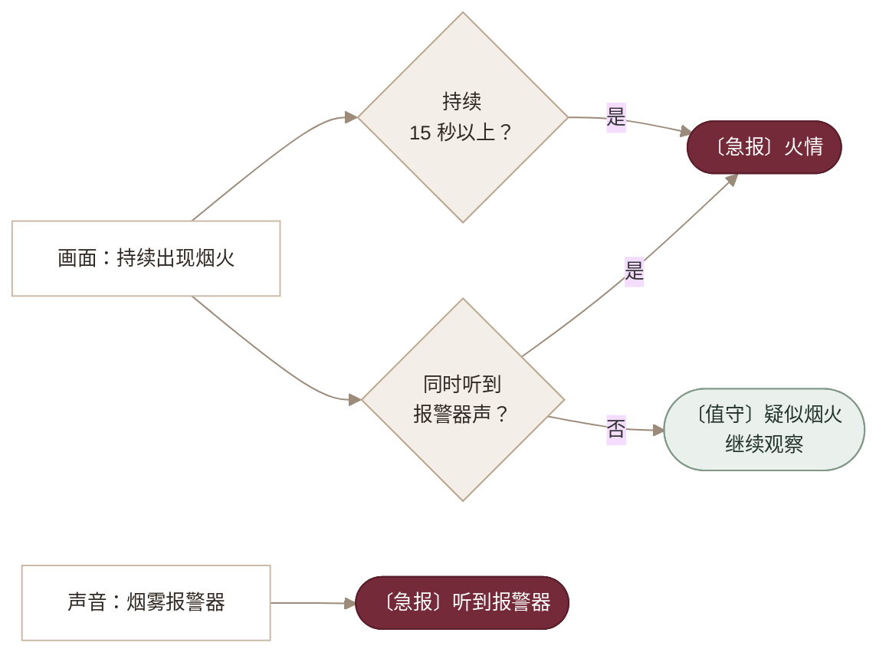

<div align="center">


# 米执事 · Mi Butler

**让小米摄像头，成为常驻家中的 AI 执事。**

没人时替你守家 · 有人时替你照看 · 养宠时替你记录<br>
画面留在家里，有事及时叫你。

[](https://github.com/JuneYaooo/caregiving-eye/stargazers)
[](./requirements.txt)
[](#执事怎样工作)
[](#三种场景执事都在做什么)
[](./LICENSE)

[三种场景](#三种场景执事都在做什么) · [怎样工作](#执事怎样工作) · [快速开始](#快速开始) · [开源组件](#站在这些开源项目上) · [常见问题](./docs/getting-started.md#常见问题)

</div>

---

**米执事（`caregiving-eye`）是一套本地运行的家庭视觉照护工具。** 把小米云台摄像头接入家里的电脑，同时“看画面、听声音”，按家里有没有人自动切换值班重点：没人时防火防盗，有人时留意跌倒、突发不适和孩子的安全，养宠时记下主子一天去了哪、动了多久。

不刷固件、不改硬件。视频和声音在局域网内传输、在本机分析；登录和连接时换取流密钥仍需访问米家云端。

## 三种场景，执事都在做什么

<table>
<tr>
<td width="33%" valign="top">

### 🛡️ 家里没人

**无人值守**

- 🔥 **火焰 / 烟雾**：画面持续出现才提醒，同时听到烟雾报警器声直接急报
- 🚨 **入侵**：出现人形即抓拍 + 录下前后短视频，可让云台转过去跟着看
- 🔊 **异常声响**：玻璃碎裂、撞击声
- ⏱️ **长时间无人**：几小时没人回家时记一笔

</td>
<td width="33%" valign="top">

### 🧓 家里有人

**在家照护 · 夜间加强**

- 🆘 **跌倒**：站立后突然倒地
- 🛏️ **倒地久卧**：倒地后迟迟没起身
- ❤️‍🩹 **突发不适**：异常位置倒卧、长时间不动、抽动、呻吟呼喊，**两种信号同时出现才急报**
- 🧒 **儿童危险**：孩子独自靠近灶台、窗台、大门，附近没有大人
- 👶 **婴儿哭声**、卫生间久留、夜间离床

</td>
<td width="33%" valign="top">

### 🐱 养了宠物

**宠物模式**

- 🗺️ **活动热力图**：一天常待在哪，叠在家里画面上
- 📊 **活动总结**：出现次数、活跃时长、最活跃时段、24 小时分布
- 🍽️ **区域停留**：猫爬架、食盆、猫砂盆各去了几次、待了多久
- 🚫 **禁区提醒**：上桌、上灶台即抓拍
- 🙀 **嘶叫哀鸣**、久未露面

</td>
</tr>
</table>

所有模式都会把事件写进本地记录，重要事件附快照和事件前后约 25 秒的短视频；`python report.py` 生成一份日报，包含事件、宠物与家人活动总结和热力图。各模式具体启用哪些能力见 [接入指南](./docs/getting-started.md#各模式启用的能力)。

> 所有判断都是规则 + 开源模型的组合，需要按自家机位标定区域、校准阈值，可能误报或漏报，**不能替代专业监护或消防报警设备**。

## 执事怎样工作

```mermaid
%%{init: {"theme": "base", "themeVariables": {"fontFamily": "PingFang SC, Microsoft YaHei, sans-serif", "fontSize": "14px", "lineColor": "#9C8B7A", "primaryTextColor": "#302923", "clusterBkg": "#FBF8F4", "clusterBorder": "#D8CCBE"}}}%%
flowchart LR
    subgraph HOME_["🏠 家里"]
        direction TB
        cam(["📷 小米云台摄像头<br/>画面 + 声音"])
    end

    subgraph PC["💻 家里的电脑 · 全部本地运行"]
        direction TB
        bridge["go2rtc + xiaomi-onvif<br/>拉流 · 云台控制"]
        subgraph SENSE["感知"]
            direction LR
            see["👁️ 看<br/>人 / 猫狗 · 姿态 · 烟火"]
            hear["👂 听<br/>报警器 · 碎裂 · 哭喊"]
        end
        track["🎯 跟踪<br/>给每个人和宠物一个编号"]
        skill["🧩 能力层<br/>跌倒 · 不适 · 儿童 · 入侵 · 宠物活动"]
        butler{{"🎩 米执事<br/>按值班模式决定提不提醒"}}
        bridge --> see & hear
        see --> track --> skill
        hear --> skill
        skill --> butler
    end

    subgraph OUT["📒 结果"]
        direction TB
        log["本地事件记录<br/>快照 · 短视频"]
        rpt["每日日报<br/>活动总结 · 热力图"]
        bot["飞书 / 微信 / QQ<br/>（可选，自行接入）"]
    end

    cloud(["☁️ 米家云端"]) -. 仅登录与换取密钥 .-> bridge
    cam == 局域网 ==> bridge
    butler --> log --> rpt
    log -. 可选转发 .-> bot
    butler -. 跟踪时转动云台 .-> bridge

    classDef device fill:#F3EEE7,stroke:#BAA58D,stroke-width:1.5px,color:#302923
    classDef cloudc fill:#FFFFFF,stroke:#BAA58D,stroke-dasharray:4 3,color:#7A6A5A
    classDef step fill:#FFFFFF,stroke:#C9B9A6,stroke-width:1.2px,color:#302923
    classDef core fill:#742A38,stroke:#5A1F2B,stroke-width:2px,color:#FFFFFF
    classDef result fill:#EAF0EB,stroke:#819888,stroke-width:1.2px,color:#23352B
    classDef optional fill:#FFFFFF,stroke:#819888,stroke-dasharray:4 3,color:#4E6556

    class cam device
    class cloud cloudc
    class bridge,see,hear,track,skill step
    class butler core
    class log,rpt result
    class bot optional
```



### 值班模式自动切换

执事根据画面里有没有人、有没有宠物自动换班，也可以按日程（如 23:00–07:00 夜间）或一句指令切换。优先级：**指令 > 日程 > 自动**，自动切换带防抖。



### 提醒分级

| 级别 | 什么时候 | 例子 |
| --- | --- | --- |
| 〔急报〕 | 需要马上有人去看，静音时也会发 | 跌倒、倒地久卧、突发不适、儿童独自进危险区、确认火情 |
| 〔值守〕 | 值得留意 | 入侵、疑似烟火、玻璃碎裂、夜间离床、长时间无动作 |
| 〔宠物〕 | 宠物相关 | 上了禁区、嘶叫哀鸣、久未露面 |
| 〔执事〕 | 日常记录 | 模式切换、长时间无人、日报 |

每类事件都有独立冷却时间，避免同一件事反复刷屏。火情、突发不适等判断都采用“**多个信号互相印证再升级**”的方式降低误报：



## 快速开始

**已实测设备**：小米智能摄像机 3 云台版。其他机型及固件版本需要另行验证。完整接入流程按 **Windows x64 + Python 3.9+** 编写。

| 步骤 | 做什么 | 入口 |
| --- | --- | --- |
| 01 · 准备环境 | 克隆仓库，安装依赖，配置 `.env`，下载模型 | [环境与配置](./docs/getting-started.md#1-准备环境) |
| 02 · 接入摄像头 | 下载配套补丁版二进制，登录米家，填写 `go2rtc.yaml` | [视频与云台](./docs/getting-started.md#2-接入摄像头) |
| 03 · 开始值班 | 标定区域，启动执事，查看日报，按需接入外部提醒 | [检测与提醒](./docs/getting-started.md#3-运行检测与提醒) |

依赖、模型和 RTSP 视频流准备好以后，在仓库根目录运行：

```powershell
# 1. 先用基础管线确认视频与模型正常
python care_pipeline.py --source rtsp://127.0.0.1:8554/living --no-display

# 2. 停掉上面的管线，启动执事（启动日志会列出实际启用的能力）
python care_v2.py --source rtsp://127.0.0.1:8554/living --no-display

# 3. 随时生成今天的日报：事件 + 宠物 / 家人活动 + 热力图
python report.py
```

火焰烟雾、声音事件、ByteTrack 跟踪都是**可选能力**：放好对应模型或装好依赖就自动启用，缺了会自动跳过，不影响其他功能。下载方式见 [可选模型](./docs/getting-started.md#可选模型按需下载缺了对应能力会自动跳过)。

<details>
<summary>项目结构</summary>

```text
care_v2.py          执事主循环：拉流 → 感知 → 按模式调度各项能力
butler.py           值班模式引擎、提醒分级与冷却、指令
report.py           日报：事件汇总、活动总结、热力图
abilities/
  fire.py           火焰 / 烟雾视觉检测
  audio.py          声音事件（YAMNet）
  illness.py        突发不适多信号判断
  child.py          儿童判定与危险区域
  pet.py            宠物 / 家人活动记录与热力图
  clips.py          事件前后短视频存证
  tracking.py       跟踪器（内置 IoU / 可选 ByteTrack）
care_pipeline.py    基础检测管线与 ONNX 推理
onvif_ptz.py        云台控制
mi_login.py 等      米家登录与设备查询
```

</details>

## 站在这些开源项目上

| 用途 | 项目 | 许可证 |
| --- | --- | --- |
| 拉流 | [go2rtc](https://github.com/AlexxIT/go2rtc) · [xiaomi-onvif](https://github.com/SincereXIA/xiaomi-onvif) | MIT |
| 人 / 宠物检测、人体姿态 | [Ultralytics YOLOv8](https://github.com/ultralytics/ultralytics)（n / n-pose） | AGPL-3.0 |
| 火焰 / 烟雾 | [D-Fire 数据集](https://github.com/gaiasd/DFireDataset) 训练的 [fire-smoke-yolov8n](https://huggingface.co/rabahdev/fire-smoke-yolov8n) | AGPL-3.0 |
| 声音事件 | Google [YAMNet](https://github.com/tensorflow/models/tree/master/research/audioset/yamnet) 的 [ONNX 版](https://huggingface.co/audiomagic/yamnet-onnx)（AudioSet 521 类） | Apache-2.0 |
| 多目标跟踪（可选） | [supervision](https://github.com/roboflow/supervision) 内置 ByteTrack | MIT |
| 推理 | [ONNX Runtime](https://github.com/microsoft/onnxruntime) · [OpenCV](https://github.com/opencv/opencv) | MIT · Apache-2.0 |

本项目代码采用 MIT；模型权重与数据集遵循各自上游许可证，商用前请自行确认。

## 实测记录

以下来自项目已有的单设备测试记录，不能代表检测准确率或所有网络环境下的性能。本次新增的火焰烟雾、声音、儿童、突发不适、宠物活动等能力尚未在真实画面上实测。

| 项目 | 已记录结果 | 观察方式 |
| --- | --- | --- |
| 视频流 | H.265 · 2960 × 1666 实时出流 | OpenCV 解码与画面时间水印 |
| 本地检测 | 35 秒分析 333 帧；一次 `person` 检出置信度 0.88 | 实时流检测输出 |
| 手动云台 | `ContinuousMove` 右转约 15–20° | 指令前后画面对比 |

## 提醒怎么发到手机

默认只写本地记录。需要机器人提醒时，可与 **OpenClaw / Hermes / WorkBuddy / ZCode / Claude Code / Codex** 等 AI 工具联合使用，读取 `events/alerts.jsonl` 并转发到飞书、微信或 QQ。本项目不内置这些平台的机器人，接入方式参考 [OpenClaw 消息渠道](https://docs.openclaw.ai/channels) 与 [Hermes 消息网关](https://hermes-agent.nousresearch.com/docs/user-guide/messaging/)，细节见 [接入指南](./docs/getting-started.md#可选飞书微信与-qq-机器人提醒)。

## 使用边界与隐私

- **需要联网取密钥**：每次连接摄像头需要向米家云端换取流密钥，目前不是完全离线方案。
- **不能替代专业设备**：火情请以烟雾报警器为准，照护请以专业监护设备为准；执事是多一双眼睛和耳朵。
- **提醒按需接入**：默认只记录在本地；使用外部机器人时，可选择只转发事件文字，不转发画面。
- **只在可信网络使用**：不要把 RTSP、go2rtc 或 ONVIF 控制端口直接暴露到公网。
- **保护家庭数据**：账号、凭据、设备清单、家庭画面、录像和区域配置都留在本地；仅在自己家中或已获明确同意的场合使用。
- **先校准，再使用**：遮挡、光线、拍摄角度与云台转动都会影响判断；转动云台后需要重新标定区域。

还没做的：双向对讲、基于骨架时序模型（ST-GCN）的跌倒分类、作息偏离提醒。设计思路见 [能力设计](./docs/butler.md) 与 [算法设计](./docs/algorithms.md)。

<div align="center">

项目代码采用 [MIT License](./LICENSE) · 社区交流：[LINUX DO](https://linux.do/)

</div>
