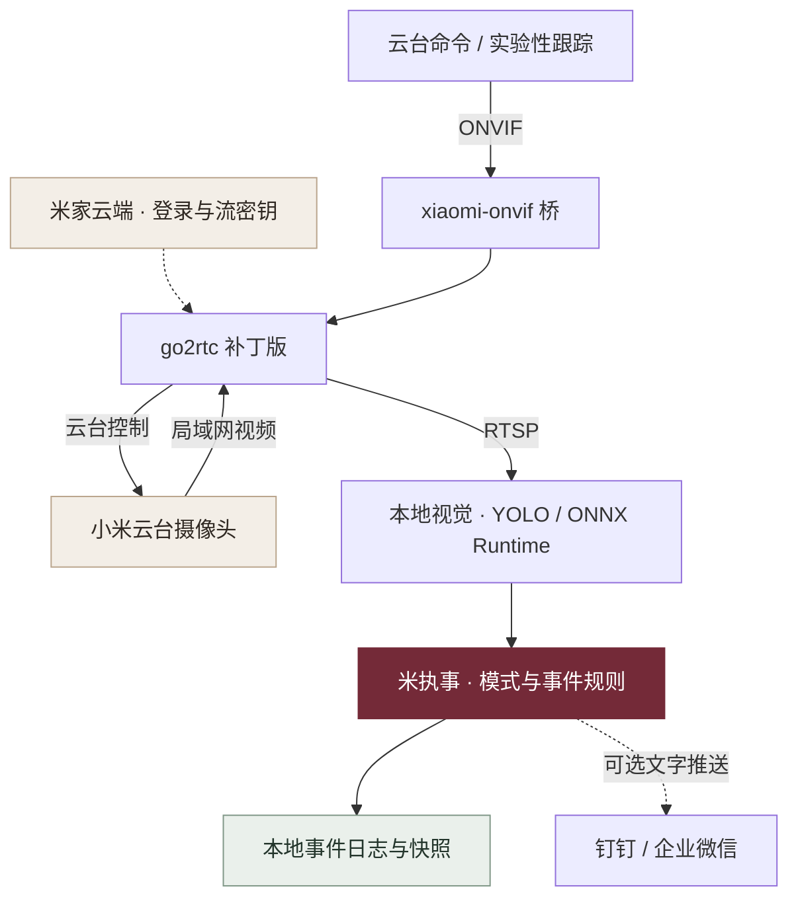

<div align="center">


# 米执事 · Mi Butler

**让小米摄像头，成为常驻家中的 AI 执事。**

本地看护 · 宠物观察 · 云台值守<br>
画面留在家里，有事及时叫你。

[](https://github.com/JuneYaooo/caregiving-eye/stargazers)
[](./requirements.txt)
[](#它是怎样工作的)
[](./LICENSE)

[能做什么](#现在能做什么) · [快速开始](#快速开始) · [实测记录](#实测记录) · [常见问题](./docs/getting-started.md#常见问题) · [路线图](#接下来做什么)

**社区交流：[LINUX DO](https://linux.do/)**

</div>

---

**米执事（`caregiving-eye`）是一套本地运行的家庭视觉照护原型。** 把小米云台摄像头接入电脑，用 YOLO 分析画面，再通过事件记录、文字通知和 ONVIF 云台控制，把“远程看一眼”变成持续的观察与提醒。

不刷固件、不改硬件。视频通过局域网传输，推理在本机完成；登录和连接时换取流密钥仍需访问米家云端。项目处于原型阶段，适合愿意按机位调试的开发者与智能家居爱好者。

## 现在能做什么

| 家庭看护 | 宠物观察 | 无人值守 |
| :--- | :--- | :--- |
| 识别人形，尝试发现跌倒、久卧和区域久滞 | 识别猫狗，对进入指定区域的行为发出提醒 | 在无人模式下记录人形事件，配合云台观察 |
| 姿态状态机与定时规则已有原型，需现场校准 | 禁区规则已有实现，活动热力图仍在完善 | 手动云台已实测，自动跟踪仍需联调 |

### 已跑通的基础链路

- **小米摄像头 → RTSP**：通过社区补丁版 go2rtc 获取局域网视频流。
- **RTSP → 本地识别**：ONNX Runtime 在本机运行 YOLO，已有实时画面检测记录。
- **ONVIF → 云台转动**：通过 xiaomi-onvif 桥发送标准云台命令。

### 已入库的执事原型

| 模块 | 当前实现 | 使用状态 |
| --- | --- | --- |
| 值班模式 | `HOME` 在家、`AWAY` 无人、`PET` 宠物、`NIGHT` 夜间；有人/无人判定、日程和指令入口 | 模式引擎已实现，复杂切换场景待验证 |
| 照护规则 | IoU 目标跟踪、姿态状态机、久卧、区域久滞、夜间活动与无人计时 | 需按画面标定区域并验证阈值 |
| 通报与记录 | 本地事件日志；可选钉钉 / 企业微信机器人文字推送；部分事件保存快照 | Webhook 为单向推送，聊天回复尚未接入 |
| 活动与日报 | 活动网格采样、事件摘要、热力图渲染代码 | 日报可汇总日志；宠物热力图读写衔接待完善 |
| 自动跟踪 | `care_v2.py --follow` 中的无人模式水平云台修正 | 实验功能，需现场联调 |

火灾 / 烟雾、异常声音、儿童危险识别、视频片段存证与双向对话仍在规划中。身份设定见 [执事设计](./docs/butler.md)，技术方向见 [算法设计](./docs/algorithms.md)；两份文档包含规划内容，当前状态以本页和代码为准。

## 快速开始

**已实测设备**：小米智能摄像机 3 云台版 · `chuangmi.camera.069a01` · 固件 `5.3.1`。同协议机型需要另行验证，不能视为全系列兼容。

完整接入流程按 **Windows x64 + Python 3.9+** 编写。Python 推理代码也可在其他平台尝试，但摄像头接入与云台链路尚无跨平台实测记录。

| 步骤 | 做什么 | 入口 |
| --- | --- | --- |
| 01 · 准备环境 | 克隆仓库，安装依赖，配置 `.env` | [环境与配置](./docs/getting-started.md#1-准备环境) |
| 02 · 接入摄像头 | 下载配套补丁版二进制，登录米家，填写 `go2rtc.yaml` | [视频与云台](./docs/getting-started.md#2-接入摄像头) |
| 03 · 开始观察 | 运行检测管线，标定区域，按需开启通知 | [检测与提醒](./docs/getting-started.md#3-运行检测与提醒) |

如果已经准备好了依赖、模型和 RTSP 视频流，在仓库根目录运行：

```powershell
# 基础检测管线：先确认视频与模型正常
python care_pipeline.py --source rtsp://127.0.0.1:8554/living --no-display
```

体验值班模式、跟踪和日报时，先停止上面的管线，再启动 v2 原型：

```powershell
python care_v2.py --source rtsp://127.0.0.1:8554/living --no-display
```

保持管线拉流，在另一个终端控制云台：

```powershell
python onvif_ptz.py right 1.2
python onvif_ptz.py stop
```

> 跌倒与异常行为判断仍是实验性规则，可能误报或漏报，不能替代专业监护设备。请先用自己的机位和测试片段验证。

## 它是怎样工作的



摄像头连接由 go2rtc 持有，视觉分析与云台控制复用这条链路。暴露出的 RTSP / ONVIF 接口可供 NVR、Home Assistant、Frigate 等系统集成，具体兼容性以各自配置与实测为准。

## 实测记录

以下来自项目已有的单设备测试记录，不能代表检测准确率或所有网络环境下的性能。

| 项目 | 已记录结果 | 观察方式 |
| --- | --- | --- |
| 视频流 | H.265 · 2960 × 1666 实时出流 | OpenCV 解码与画面时间水印 |
| 本地检测 | 35 秒分析 333 帧；一次 `person` 检出置信度 0.88 | 实时流检测输出 |
| 手动云台 | `ContinuousMove` 右转约 15–20° | 指令前后画面对比 |

## 接下来做什么

- **把规则跑稳**：更多机位下的姿态、模式切换与定时器验证，完善宠物热力图和日报。
- **补齐值守闭环**：自动跟踪联调、事件视频片段、可接收回复的消息入口。
- **加入声音**：哭声、呼救、玻璃碎声与烟警器提示音的本地识别。
- **融合更多信号**：火灾 / 烟雾、儿童危险区域与时序骨架分析。

欢迎通过 [Issues](https://github.com/JuneYaooo/caregiving-eye/issues) 分享机型兼容性、脱敏日志与复现步骤，或通过 [Pull Requests](https://github.com/JuneYaooo/caregiving-eye/pulls) 改进实现。

## 使用边界与隐私

- **需要联网取密钥**：每次连接摄像头需要向米家云端换取流密钥，目前不是完全离线方案。
- **通知按需开启**：默认记录在本地；配置 `ALERT_WEBHOOK` 后会将事件文字发送到对应平台。v2 不上传快照图片。
- **只在可信网络使用**：不要把 RTSP、go2rtc 或 ONVIF 控制端口直接暴露到公网。
- **保护家庭数据**：账号、凭据、设备清单、家庭画面和区域配置应留在本地；仅在自己家中或已获明确同意的场合使用。
- **先校准，再使用**：遮挡、光线、拍摄角度与云台转动都会影响规则判断；固定画面区域在转动后需要重新标定。

## 项目导航

| 想了解什么 | 从这里开始 |
| --- | --- |
| 安装、模型、配置与排错 | [接入指南](./docs/getting-started.md) |
| 值班制度与角色设计 | [执事设计](./docs/butler.md) |
| 算法路线与后续能力 | [算法设计](./docs/algorithms.md) |
| 感知管线 | [基础管线](./care_pipeline.py) · [v2 原型](./care_v2.py) |
| 模式、通知与日报 | [butler.py](./butler.py) · [report.py](./report.py) |

感谢 [go2rtc](https://github.com/AlexxIT/go2rtc)、[xiaomi-onvif](https://github.com/SincereXIA/xiaomi-onvif)、[Ultralytics](https://github.com/ultralytics/ultralytics) 与 [ONNX Runtime](https://github.com/microsoft/onnxruntime) 提供基础能力。

项目代码采用 [MIT License](./LICENSE)，模型权重遵循各自上游许可证。个人开源项目，与小米公司无隶属关系。
