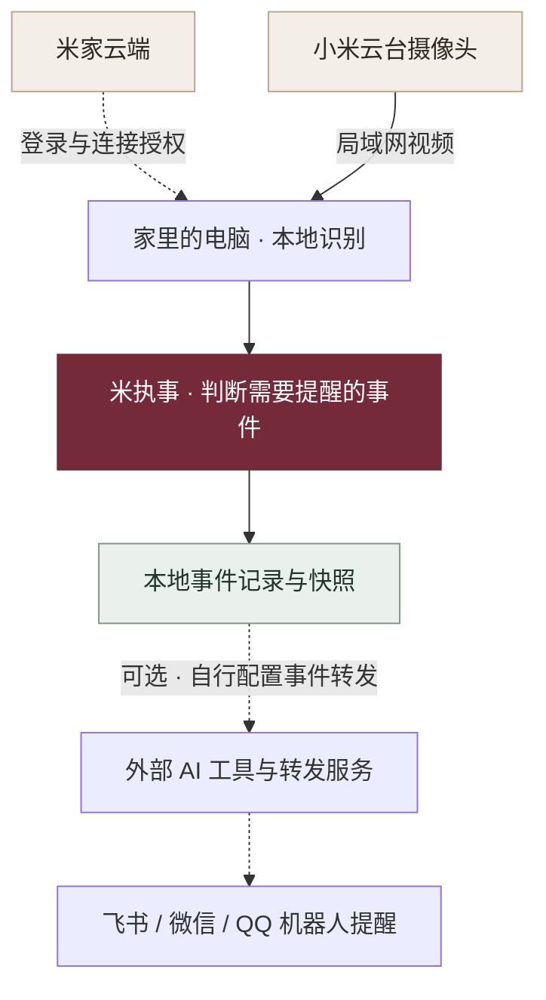

<div align="center">


# 米执事 · Mi Butler

**让小米摄像头，成为常驻家中的 AI 执事。**

本地看护 · 宠物观察 · 云台值守<br>
画面留在家里，有事及时叫你。

[](https://github.com/JuneYaooo/caregiving-eye/stargazers)
[](./requirements.txt)
[](#画面怎样处理)
[](./LICENSE)

[能做什么](#现在能做什么) · [快速开始](#快速开始) · [实测记录](#实测记录) · [常见问题](./docs/getting-started.md#常见问题)

</div>

---

**米执事（`caregiving-eye`）是一套本地运行的家庭视觉照护工具。** 把小米云台摄像头接入电脑，识别画面中的人和宠物，记录异常事件，并可结合外部机器人发送提醒。

不刷固件、不改硬件。视频通过局域网传输，画面分析在本机完成；登录和连接时换取流密钥仍需访问米家云端。当前版本需要自行安装和配置，并根据实际机位校准检测规则。

## 现在能做什么

| 家庭看护 | 宠物观察 | 无人值守 |
| :--- | :--- | :--- |
| 识别人形，尝试发现跌倒、久卧和区域久滞 | 识别猫狗，对进入指定区域的行为发出提醒 | 在无人模式下记录人形事件，配合云台观察 |
| 姿态状态机与定时规则已有原型，需现场校准 | 禁区规则已有实现，活动热力图仍在完善 | 手动云台已实测，自动跟踪仍需联调 |

### 执事功能

| 功能 | 可以做什么 | 使用说明 |
| --- | --- | --- |
| 值班模式 | 在家、无人、宠物、夜间四种模式，可按检测情况和日程切换 | 使用前需检查实际切换是否符合家中情况 |
| 照护提醒 | 尝试发现跌倒、久卧、区域久滞与夜间活动 | 需按画面设置区域并校准阈值，可能误报或漏报 |
| 宠物禁区 | 猫狗进入指定区域时提醒 | 按自己的画面设置禁区 |
| 通知与记录 | 保存本地事件记录，部分事件附带快照；可联动飞书 / 微信 / QQ 机器人提醒 | 需另行配置外部机器人与事件转发 |
| 每日摘要 | 汇总当天记录的事件 | 暂不提供完整的宠物活动热力图 |
| 云台控制 | 手动调整摄像头朝向；可尝试无人模式下自动跟踪 | 自动跟踪为实验功能，转动后需重新检查区域设置 |

需要机器人提醒时，可与 **OpenClaw / Hermes / WorkBuddy / ZCode / Claude Code / Codex** 等 AI 工具联合使用，另行配置事件转发与消息渠道。本项目不内置飞书、微信或 QQ 机器人，接入方式可参考 [OpenClaw 消息渠道](https://docs.openclaw.ai/channels)与 [Hermes 消息网关](https://hermes-agent.nousresearch.com/docs/user-guide/messaging/)。

目前尚不支持火灾 / 烟雾、异常声音、儿童危险识别、视频片段存证与双向对话。

## 快速开始

**已实测设备**：小米智能摄像机 3 云台版。其他机型及固件版本需要另行验证。

完整接入流程按 **Windows x64 + Python 3.9+** 编写。Python 推理代码也可在其他平台尝试，但摄像头接入与云台链路尚无跨平台实测记录。

| 步骤 | 做什么 | 入口 |
| --- | --- | --- |
| 01 · 准备环境 | 克隆仓库，安装依赖，配置 `.env` | [环境与配置](./docs/getting-started.md#1-准备环境) |
| 02 · 接入摄像头 | 下载配套补丁版二进制，登录米家，填写 `go2rtc.yaml` | [视频与云台](./docs/getting-started.md#2-接入摄像头) |
| 03 · 开始观察 | 运行检测管线，标定区域，按需接入外部提醒 | [检测与提醒](./docs/getting-started.md#3-运行检测与提醒) |

如果已经准备好了依赖、模型和 RTSP 视频流，在仓库根目录运行：

```powershell
# 基础检测管线：先确认视频与模型正常
python care_pipeline.py --source rtsp://127.0.0.1:8554/living --no-display
```

体验值班模式、跟踪和日报时，先停止上面的管线，再启动 v2 原型：

```powershell
python care_v2.py --source rtsp://127.0.0.1:8554/living --no-display
```

保持管线拉流，在另一个终端控制云台：

```powershell
python onvif_ptz.py right 1.2
python onvif_ptz.py stop
```

> 跌倒与异常行为判断仍是实验性规则，可能误报或漏报，不能替代专业监护设备。请先用自己的机位和测试片段验证。

## 画面怎样处理



视频在本机分析，事件记录与快照保存在本机。外部机器人提醒需另外接入，发送内容由所配置的转发规则决定。

## 实测记录

以下来自项目已有的单设备测试记录，不能代表检测准确率或所有网络环境下的性能。

| 项目 | 已记录结果 | 观察方式 |
| --- | --- | --- |
| 视频流 | H.265 · 2960 × 1666 实时出流 | OpenCV 解码与画面时间水印 |
| 本地检测 | 35 秒分析 333 帧；一次 `person` 检出置信度 0.88 | 实时流检测输出 |
| 手动云台 | `ContinuousMove` 右转约 15–20° | 指令前后画面对比 |

## 使用边界与隐私

- **需要联网取密钥**：每次连接摄像头需要向米家云端换取流密钥，目前不是完全离线方案。
- **提醒按需接入**：默认记录在本地；使用外部机器人时，可选择仅转发必要的事件文字。
- **只在可信网络使用**：不要把 RTSP、go2rtc 或 ONVIF 控制端口直接暴露到公网。
- **保护家庭数据**：账号、凭据、设备清单、家庭画面和区域配置应留在本地；仅在自己家中或已获明确同意的场合使用。
- **先校准，再使用**：遮挡、光线、拍摄角度与云台转动都会影响规则判断；固定画面区域在转动后需要重新标定。

感谢 [go2rtc](https://github.com/AlexxIT/go2rtc)、[xiaomi-onvif](https://github.com/SincereXIA/xiaomi-onvif)、[Ultralytics](https://github.com/ultralytics/ultralytics) 与 [ONNX Runtime](https://github.com/microsoft/onnxruntime) 提供基础能力。

项目代码采用 [MIT License](./LICENSE)，模型权重遵循各自上游许可证。

**社区交流：[LINUX DO](https://linux.do/)**
