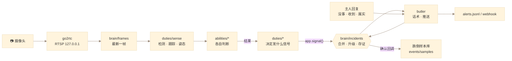

# 代码架构

[← 返回 README](../README.md)

所有代码都在 `mibutler/` 包里，根目录只有一个入口 `main.py`。各层只依赖下层，想改哪类行为，基本只需要看一个目录。

## 目录

```text
main.py                     命令行入口：run / serve / health / check / login / devices / find-camera / ptz / report / cmd
mibutler/
  app.py                    组装：加载模型、启动服务、各能力实例化；signal() 把发现交给研判层；主循环
  duties/                   值班任务：每项任务做什么、多久做一次
    __init__.py             值班表（全部任务集中在这一张表）
    sense.py                看与听：看门狗、动静、检测跟踪、姿态与跌倒、声音事件
    safety.py               安全：火焰烟雾、入侵
    care.py                 照护：突发不适、儿童危险、卫生间久滞 / 夜间离床、作息偏离、长时间无人
    pets.py                 宠物：禁区、久未露面
    records.py              记录与保养：活动统计、心跳、清理、底图、云台复位与画面对齐、跌倒样本、日报
  brain/                    调度与研判（详见 brain.md）
    runtime.py              调度器：周期 / 触发 / 一次性 / 每日任务，cpu 与 io 两条车道，过载让路，失败退避
    frames.py               拉流线程：只留最新帧，断流重连
    gate.py                 帧差动静 + 三档警觉等级
    incidents.py            事件研判：合并、升级、催办、结案、误报学习、确认回调
    ptz.py                  云台独占与复位；ViewCheck 画面对齐检查
    upkeep.py               磁盘清理、日志轮转、心跳文件
    supervisor.py           守护：拉起 go2rtc / 云台桥 / 执事，崩溃或卡死自动重启并通报
  abilities/                能力：每个模块只做一种判断，返回结果，不直接发通知
    presence.py             谁算人：动过 + 关键点可信 + 不在家具格；换编号继承；全系统统一口径
    fall.py                 姿态状态机、家具化过滤、跌倒样本库
    fall_gcn.py             ST-GCN 骨架时序跌倒分类 + 与规则的并联研判
    illness.py              突发不适多信号合并
    child.py                儿童判定与危险区域
    fire.py                 火焰 / 烟雾视觉检测
    audio.py                声音事件（YAMNet）
    activity.py             宠物 / 家人活动记录与热力图
    routine.py              作息偏离
    clips.py                事件前后短视频存证
  vision/                   模型：只管推理，不含业务规则
    yolo.py                 YOLOv8 检测 / 姿态 ONNX 推理
    tracker.py              内置 IoU 跟踪器
    tracking.py             跟踪器工厂（可选 ByteTrack）
  camera/                   摄像头接入
    mi_login.py             米家登录（生成 mi_creds.json）
    mi_api.py               米家云 API（设备清单）
    discover.py             局域网扫描小米设备
    onvif.py                ONVIF 云台指令
  butler.py                 执事：值班模式、通报话术、推送、主人指令入口
  report.py                 日报
  zones.py                  区域标定读取、点在多边形、误报格子
  config.py                 读取 .env
scripts/
  fall_gcn/                 跌倒骨架模型：下载数据、提取关键点、训练、试跑（需要 PyTorch，运行时不需要）
  windows/                  Windows 辅助：start_stack.bat、install_autostart.ps1、install_firewall.ps1
docs/                       文档
```

## 一帧画面怎样变成一条提醒



- **abilities 不发通知**：它们只回答“是不是”。要不要提醒、提醒到什么级别，由 `duties/` 里的任务决定，再交给研判层合并。
- **duties 不持有状态**：任务函数签名都是 `fn(app, c)`；组件在 `app` 上，本次运行的共享状态在 `c`（`app.Ctx`）。
- **加一项新能力**：在 `abilities/` 写判断逻辑 → 在 `duties/` 写一个任务函数调用它并 `app.signal(...)` → 在 `duties/__init__.py` 的值班表里加一行 → 在 `brain/incidents.py` 的 `FAMILY` 里把新事件类型归类。可选能力在 `app.py` 里用 `from_env()` 加载，缺依赖返回 `None`，值班表里按 `if app.xxx:` 排班。

## 运行方式

| 场景 | 命令 |
| --- | --- |
| 调试、用录像校准 | `python main.py run --source my_living_room.mp4` |
| 日常值守 | `python main.py serve`：守护进程拉起 go2rtc、云台桥和执事，崩溃或 3 分钟没心跳自动重启 |
| 开机自启（Windows） | `scripts\windows\install_autostart.ps1` 注册登录后运行 `main.py serve` 的计划任务 |
| 外部机器人检查是否在岗 | `python main.py health`，掉线时退出码为 1 |

## 运行时文件（都在 events/，不提交）

| 文件 | 内容 |
| --- | --- |
| `alerts.jsonl` | 每条提醒 |
| `incidents.jsonl` | 结案的事件：持续时长、是否确认、快照与录像 |
| `feedback.jsonl` | 主人回复“没事”的记录，用于按画面位置降级 |
| `status.json` | 心跳，每 30 秒更新 |
| `activity_<pet|person>_YYYYMMDD.json`、`heatmap_*.npy` | 活动统计，作息对比用，保留 400 天 |
| `snap_*.jpg`、`clips/clip_*.mp4` | 快照与录像，保留 `RETAIN_DAYS` 天 |
| `furniture_cells.json` | 家具格子记忆（静物常驻的位置，6 小时衰减） |
| `samples/fall_*.npz` + `.json` | 跌倒样本（只有关键点坐标）与确认标签 |
| `logs/*.log` | 守护模式下各进程的输出 |
