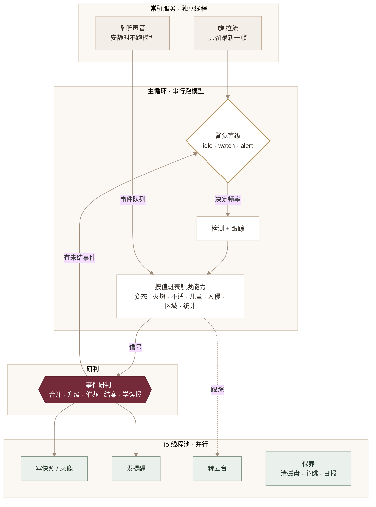
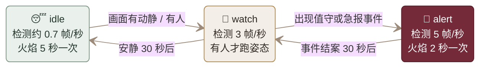

# 执事的大脑：怎样调度这些能力

[← 返回 README](../README.md)

只把能力一个个接进来是不够的。一台家用电脑要 7×24 小时同时“看、听、判断、记录”，需要回答四个问题：

1. **什么时候跑什么**：没人时还要每秒跑 3 次姿态模型吗？
2. **谁先谁后、谁能并行**：模型推理、写录像、发消息、转云台会不会互相卡住？
3. **信号怎样变成一次靠谱的提醒**：跌倒、久卧、不适是同一件事，不该连发三条急报。
4. **怎样跑上几个月不出问题**：断流、模型报错、磁盘写满、云台转歪了怎么办？

`brain/` 目录负责这四件事，`care_v2.py` 里的任务列表（“值班表”一段）就是执事的排班。

## 总览

## 1. 任务分四类

| 类型 | 特点 | 例子 | 实现 |
| --- | --- | --- | --- |
| 常驻服务 | 一直运行，挂了要自动拉起 | 拉流、听声音 | 独立线程，看门狗每 10 秒检查一次 |
| 周期任务 | 按间隔反复执行，间隔可随警觉等级变化 | 检测、火焰、催办、心跳、清磁盘 | `Task(every=...)` |
| 触发任务 | 有新检测结果才执行 | 姿态、不适、儿童、入侵、区域规则、活动统计 | `Task(trigger='detect')` |
| 一次性任务 | 执行一次就结束 | 写快照、转云台、主人说“看看”时抓拍 | `sched.once(...)` |
| 每日任务 | 每天固定时刻 | 日报（默认 21:30） | `sched.daily(...)` |

## 2. 两条车道：哪些串行，哪些并行

- **cpu 车道（主循环，串行）**：所有模型推理。几个 ONNX 模型同时跑只会互相抢 CPU、谁都变慢，串行反而更快更稳；每个模型的线程数由 `ORT_THREADS` 限制（默认 2），给视频解码留出余量。
- **io 车道（2 个线程，并行）**：写图片、写录像、发 webhook、转云台、清磁盘、写心跳。这些事慢但不吃 CPU，放到后台不阻塞识别。
- **常驻线程**：拉流线程只保留最新一帧，避免推理慢时画面越积越旧；声音线程把识别结果放进队列，由主循环统一处理，所有通知都经过同一个研判层。

## 3. 按需花算力：警觉等级

- **动静判断几乎不花钱**：把画面缩到 320 宽的灰度图做帧差。开灯、红外夜视切换导致整幅画面变化时，当作光照变化忽略。
- **升级立刻生效，降级要等安静一段时间**（`CALM_DOWN_SEC`），避免来回抖动。
- **按条件跑模型**：姿态模型只在画面里有人时跑；火焰模型闲时 5 秒查一次，一旦有可疑命中立刻加密到每 0.5 秒，凑够连续证据再判断。声音模型在环境音低于 −60 dB 时不运行。
- **过载让路**：一轮 cpu 任务超过预算（`TICK_BUDGET`，默认 0.6 秒）时，优先级 ≥ 5 的统计类任务本轮跳过，跌倒、火情等永远先跑。

家里白天上班、晚上睡觉时，大部分时间处在 idle。`events/status.json` 的 `level_share` 记录了各等级的时间占比，可以据此观察实际省下多少算力。

## 4. 值班表

| 任务 | 频率 | 优先级 | 模式 | 条件 |
| --- | --- | --- | --- | --- |
| 看门狗 | 10 秒 | 0 | 全部 | — |
| 动静判断 | 0.2 秒 | 0 | 全部 | 有新帧 |
| 检测 + 跟踪 | 按警觉等级 | 1 | 全部 | 有新帧 |
| 姿态（跌倒 / 久卧） | 每次检测后 | 1 | 全部 | 画面有人 |
| 火焰烟雾 | 5 / 3 / 2 秒，可疑时 0.5 秒 | 2 | 全部 | 已放模型 |
| 声音事件 | 0.25 秒取一次队列 | 2 | 全部 | 已放模型 |
| 入侵 | 每次检测后 | 2 | 无人 · 宠物 | 画面有人 |
| 突发不适 | 每次检测后 | 3 | 在家 · 夜间 | 画面有人 |
| 儿童危险 | 每次检测后 | 3 | 全部 | `HAS_CHILD=1`、有人、云台在原位 |
| 事件催办与结案 | 5 秒 | 3 | 全部 | — |
| 区域规则 | 每次检测后 | 4 | 全部 | 云台在原位 |
| 活动统计与热力图 | 每次检测后 | 6（可让路） | 全部 | 云台在原位 |
| 长时间无人 / 宠物久未露面 | 1 / 5 分钟 | 7 | 全部 / 宠物 | — |
| 保存统计、写心跳 | 5 分钟 / 30 秒 | io | 全部 | — |
| 无人底图、清磁盘、日志轮转 | 10 分钟 / 1 小时 | io | 全部 | — |
| 云台复位 | 5 秒 | io | 全部 | 开启 `--follow` |
| 日报 | 每天 `REPORT_AT` | io | 全部 | — |

## 5. 研判：信号不等于提醒

能力模块只上报**信号**，由 `brain/incidents.py` 决定怎样提醒：

| 机制 | 做法 | 解决的问题 |
| --- | --- | --- |
| 合并 | 同一类、同一对象的信号归为一个事件：同一人的跌倒 → 久卧 → 不适是一件事 | 一件事连发多条急报 |
| 升级 | 只有级别变高才再次提醒，并标明“升级” | 同级信号刷屏 |
| 按需存证 | 只在事件新建或升级时抓拍和录像 | 同一件事写满磁盘 |
| 催办 | 急报无人回复，每 `REMIND_SEC` 秒再提醒，最多 `MAX_REMINDS` 次 | 手机静音没看到 |
| 结案 | 一段时间没有新信号自动结案；急报要更久，并提示去看录像 | 事件永远挂着 |
| 学误报 | 回复“没事”记为误报；同一类型在同一画面位置 14 天内误报 3 次，以后在此降一级提醒（火情除外） | 固定位置反复误报，让人不再信任提醒 |

主人的回复：`没事`（误报）、`收到`（停止催办）、`是我`（解除入侵并切到在家）、`状态`、`看看`（立即抓拍）、`静音2小时`、`模式 away`、`日报`。回复从本机指令入口 `http://127.0.0.1:8766/command` 进来，命令行可用 `python butler.py cmd 收到`。

## 6. 长期运行

| 风险 | 对策 |
| --- | --- |
| 推理慢导致画面越来越旧 | 拉流线程用 `grab()` 跟上实时流，只在需要时解码图像 |
| 断流、摄像头重启 | 1s、2s、4s…最多 30s 退避重连；中断超过 `STREAM_DOWN_SEC` 发一条值守提醒，恢复后再告知 |
| 线程意外退出 | 看门狗重新拉起拉流、声音线程 |
| 某个能力报错 | 只暂停这一项，10 秒起指数退避后重试，其他能力照常；错误记录在 `status.json` |
| 磁盘写满 | 快照、录像保留 `RETAIN_DAYS` 天，总量超过 `MAX_EVENTS_GB` 从最旧的删；活动统计很小，保留 400 天 |
| 日志无限增长 | `alerts.jsonl`、`incidents.jsonl` 超过 20 MB 自动归档 |
| 网络卡顿拖慢识别 | webhook 走后台队列，失败重试 3 次 |
| 云台转动后区域错位 | 云台由一处统一控制并加锁；转动期间区域规则和热力图暂停；目标离开 60 秒后反向转回原位 |
| 跨天 | 活动统计按天切换并落盘；重启后接着当天数据继续 |
| 不知道执事是否还在岗 | 每 30 秒写 `events/status.json`：模式、警觉等级、各任务平均耗时 / 跳过 / 失败次数、拉流帧率、未结事件、磁盘占用 |

## 7. 调参入口

| 配置 | 默认 | 说明 |
| --- | --- | --- |
| `DETECT_IDLE_SEC` / `DETECT_FPS` / `DETECT_ALERT_FPS` | 1.5 / 3 / 5 | 三个警觉等级的检测频率 |
| `CALM_DOWN_SEC` | 30 | 降级前需要安静的秒数 |
| `ORT_THREADS` | 2 | 每个视觉模型的推理线程数 |
| `TICK_BUDGET` | 0.6 | 一轮 cpu 任务的耗时预算（秒） |
| `REMIND_SEC` / `MAX_REMINDS` | 180 / 5 | 急报催办间隔与次数 |
| `STREAM_DOWN_SEC` | 120 | 断流多久提醒 |
| `RETAIN_DAYS` / `MAX_EVENTS_GB` | 7 / 5 | 快照与录像的保留天数和总量上限 |
| `REPORT_AT` | 21:30 | 每日日报时间 |

## 8. 用录像校准

`--source` 也可以是本地录像文件，会按原始帧率播放、播完从头再放。先录一段自家画面（走动、坐下、躺下、宠物上桌），反复回放调区域和阈值，比直接上线可靠得多。

## 目前的局限

- 云台复位按“反向转同样时长”近似，长期会有漂移，需要定期在米家 App 里校正。
- 警觉等级只看画面动静和人，不看声音；夜里摄像头看不到的地方有动静，只能靠声音模块单独报。
- 误报学习按画面 6×4 格子记，云台转动后格子含义会变。
- 跟踪器在多人贴身交叉时仍可能换号，建议有条件时用 `TRACKER=bytetrack`。
